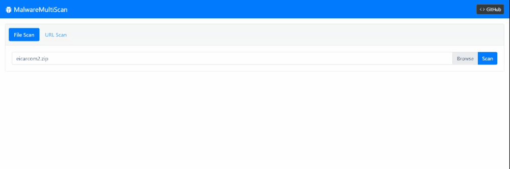

# Panoptes

Self-hosted multi-antivirus scanning API - a single endpoint, many engines. Upload a file or URL, every antivirus container in the pool scans it, you get one verdict list back.

Fork of [MalwareMultiScan](https://github.com/mindcollapse/MalwareMultiScan) v1.5 (MIT, (c) Volodymyr Smirnov), modernized to .NET 8 and rebuilt to run **fully offline-first** on networks with heavy filtering (no external service dependencies at scan time).



## Why

VirusTotal was not an option: data residency, file samples leaving the network, and regional blocking. Panoptes keeps everything local: files never leave your infrastructure, engines update from vendor CDNs (optionally through a proxy), scans run in isolated throwaway containers.

**Note**: Panoptes is not intended as a publicly-facing API/UI. It has no authorization, authentication, rate-limiting, or logging - use it internally or behind a restrictive gateway.

## Engine status

| Engine | Verdict on EICAR | Database freshness model | Notes |
|--------|-----------------|--------------------------|-------|
| ClamAV | DETECTED | updates at runtime (best-effort) | fully reliable |
| Dr.Web 11.1 | DETECTED | updates at runtime (best-effort) | demo license re-fetched at build, stats daemon disabled |
| eScan 7.0 | DETECTED | frozen bases at build + background update | works with stale shipped bases |
| McAfee VSCAN 6.0.4 | DETECTED | frozen DATs at build (Nov 2026) + background update | 2013 engine still loads current DATs |
| Windows Defender | DETECTED | frozen engine cab + loader rebuilt from pinned loadlibrary | needs a one-time `docker cp` engine export from a machine where the Defender container already works (Microsoft rotates mpengine monthly; current cabs outgrow the dormant loader) |
| Kaspersky KES 10.1.1 | DETECTED | frozen bases + license export | one-time `docker cp` of `/var/opt/kaspersky/kesl` from a Kaspersky-reachable machine |
| ESET Server Security | pending | frozen modules at build | needs a trial keycode (ESET business portal); install + update + scan chain verified |
| Comodo | dead end | - | vendor abandoned the Linux CLI engine (bases frozen at 2013); excluded |
| Padvish 3.2.152.537 | DETECTED | fully vendored (offline bundle + Windows companion DB) | regional vendor, no proxy needed; build-time EICAR check |
| dummy | DETECTED | - | pipeline validator, no real AV |

## Quickstart

```bash
# 1. fetch vendor installers the Docker build cannot reach (run on host)
./scripts/fetch-vendor.sh            # KES deb, McAfee engine tarball
# optional one-time frozen exports (recipes below)
#   vendor/kesl-bases.tar, vendor/defender-engine.tgz - from a machine where
#   those containers already work:
#
#   KES:      docker compose exec kes-scanner tar cC /var/opt/kaspersky kesl \
#             | gzip > MalwareMultiScan.Backends/Dockerfiles/vendor/kesl-bases.tar
#
#   Defender: docker cp windows-defender-scanner-container:/opt/engine - \
#             | gzip > MalwareMultiScan.Backends/Dockerfiles/vendor/defender-engine.tgz

# 2. build the shared scanner base image (engines inherit it)
docker build -f MalwareMultiScan.Scanner/scanner-base.Dockerfile \
  -t panoptes-scanner-base:local .
# on restricted networks where deb.debian.org is unreachable, point apt
# at a mirror (same env var for the windows-defender compose build):
#   --build-arg DEBIAN_MIRROR=https://mirror.yandex.ru \
#   --build-arg DEBIAN_SECURITY_MIRROR=https://mirror.yandex.ru
# (args replace the host part only - the /debian and /debian-security
# suite paths come from the stock sources file)

# 3. start the core
docker compose up -d                 # api, ui, redis, mongo, consul, dummy-scanner

# 4. add engines (each is a compose profile)
docker compose --profile clamav --profile drweb up -d

# 5. verify end to end
ENGINES="clamav drweb" ./scripts/e2e-core.sh
```

Web UI: http://localhost:8888 - API: http://localhost:5000 (`POST /api/queue/url`, `POST /api/queue/file`).

### Profiles

`clamav` `drweb` `mcafee` `escan` `kes` `padvish` `comodo` `e2e` (curl helper). Enable any subset at `docker compose up`.

### Environment

API / Scanner configuration is via environment variables (see `MalwareMultiScan.Api/appsettings.json` and `docker-compose.yaml`):

| Variable | Default | Description |
|----------|---------|-------------|
| `MONGO_ADDRESS` | `mongodb://localhost:27017` | MongoDB connection string |
| `MONGO_DATABASE` | `MalwareMultiScan` | database name |
| `REDIS_ADDRESS` | `localhost:6379` | Redis address for the Hangfire job queue |
| `CONSUL_ADDRESS` | `http://localhost:8500` | Consul for scanner service discovery |
| `WORKER_COUNT` | `1` | scan workers per scanner container |
| `PANOPTES_TIMEOUT` | `120` | seconds before a scan result is marked TIMEOUT |
| `PANOPTES_UPDATE_ATTEMPTS` | `6` | database-update retries at engine startup |
| `PANOPTES_DEBIAN_MIRROR` | `https://deb.debian.org` | Debian mirror for apt during image builds (pass through to the base image build and engine builds) |
| `PANOPTES_DEBIAN_SECURITY_MIRROR` | `https://deb.debian.org` | Debian security mirror, same usage |
| `PANOPTES_<ENGINE>_STRICT` | unset | set to `1` to refuse starting an engine whose database update failed (default: stale databases keep serving) |

### Build-time vendoring

Vendor installers and frozen databases live in `MalwareMultiScan.Backends/Dockerfiles/vendor/` (gitignored). `scripts/fetch-vendor.sh` downloads what is downloadable from the host; frozen-base exports come from one-time runs on networks that can reach the vendor (recipes in the script header). Engines degrade loudly, never silently: a KES container without bases and without an imported export refuses to start; a McAfee container with stale DATs starts and warns.

## Architecture

- **API** - .NET 8 + Hangfire (Redis queues) + MongoDB result store. Enqueues scans, aggregates results, serves the UI.
- **Scanners** - one container per engine, from a shared `panoptes-scanner-base:local` image (.NET 8 runtime + worker). Each registers in Consul with its engine id; the API only dispatches to registered scanners.
- **UI** - Nuxt demo frontend.

Scanners wrap the vendor command-line utility and parse its output with a regular expression (see `MalwareMultiScan.Backends/Backends/`). Adding an engine = one Dockerfile + one backend class + one compose service.

## Deployment notes

- Target: plain Ubuntu server + Docker. Images build with `docker compose build` per profile; engines self-update at runtime only when the vendor CDN is reachable - otherwise they run on the baked databases.
- On restricted networks set `PANOPTES_BUILD_PROXY=http://<proxy>:<port>` for build-time fetches and add `extra_hosts: ["host.docker.internal:host-gateway"]` so runtime updates can use the host proxy.
- The Windows Defender engine cab and KES databases are vendor-rotated; if e2e hard-fails after a vendor change, re-export per the recipes in `scripts/fetch-vendor.sh`.

### Running with a partial engine set

Engines are independent compose profiles - nothing breaks when some cannot be downloaded or built:

- The core (`api`, `ui`, `redis`, `mongo`, `consul`, `dummy-scanner`) has no profile and always starts. The API works even with zero engines (every scan then reports `TIMEOUT`).
- Build/start engines individually (`docker compose --profile drweb build drweb-scanner`, then `up -d`). A failing engine build never takes down the core or other engines - avoid batching all profiles in one `up` command on a flaky network, because one failed build aborts the batch.
- Missing engines simply show a `TIMEOUT` verdict per scan; `e2e-core.sh` exits non-zero listing them. Add engines later without touching the rest.

### Fresh Ubuntu VM runbook (ESXi)

```bash
# on the VM (Ubuntu 22.04+ with Docker + git clone of this repo)
cd Panoptes

# 1. fetch vendor installers the build cannot reach (KES deb, McAfee tarball;
#    tries direct downloads first, falls back to PANOPTES_FETCH_PROXY)
bash scripts/fetch-vendor.sh

# 2. drop in the one-time frozen exports if you have them (else engines
#    still build, they just self-update or run stale until exported):
#    vendor/kesl-bases.tar (962MB), vendor/defender-engine.tgz (98MB),
#    vendor/drweb.run (633MB, fetch-vendor.sh downloads it)

# 3. build everything reachable, one profile at a time
for p in clamav drweb escan mcafee windows-defender kes padvish; do
  docker compose --profile $p build || echo "SKIP $p"
done

# 4. start core + whatever built
docker compose up -d
for p in clamav drweb escan mcafee windows-defender kes padvish; do
  docker compose --profile $p up -d || true
done

# 5. verify (all green engines must DETECT EICAR)
ENGINES="dummy clamav windows-defender drweb kes mcafee escan padvish" PANOPTES_TIMEOUT=300 \
  bash scripts/e2e-core.sh
```

UI on :8888, API on :5000 inside the compose network. Engines that failed to build show `TIMEOUT` until you add them - see "Running with a partial engine set".

## Credits

- [MalwareMultiScan](https://github.com/mindcollapse/MalwareMultiScan) by Volodymyr Smirnov - the original architecture (MIT).
- [taviso/loadlibrary](https://github.com/taviso/loadlibrary) (+ [v-p-b](https://github.com/v-p-b/loadlibrary) fixes) - Windows Defender engine loader.
- Engine vendors - all engines run their official Linux CLI builds.
